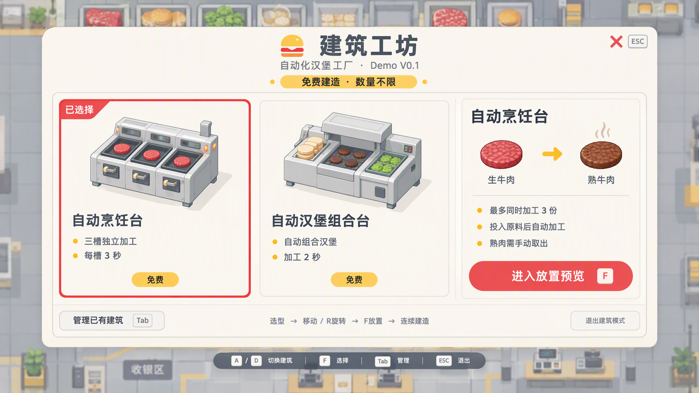

# 建筑工坊 UI 设计 V1

2026-10-15，用户要求调用 Tap 制造，为当前 Demo 生成建筑页面设计图。已完成一张1920×1080设计图，本次未修改游戏代码。

- 风格：奶油白、番茄红、芥末黄，餐饮设备插画，圆角卡片。
- 左侧两张建筑卡：自动烹饪台（三槽独立、每槽3秒）、自动汉堡组合台（加工2秒）。
- 右侧设备详情及进入放置预览；底部管理已有建筑、退出与键盘提示。
- 免费建造、数量不限；选型后直接预览，可移动、旋转、放置并连续建造。
- 设备插画和背景为美术提案，非现有游戏实拍。图中布局已视觉检查，中文与关键功能可读。未增加价格、升级、解锁或自动物流。

来源、完整提示词和平台结果保存在同名maker-result.json。平台自动下载失败，浏览器保存原图成功后复制入项目；没有重复付费生成。实际积分及余额平台未返回，按台账记录。
