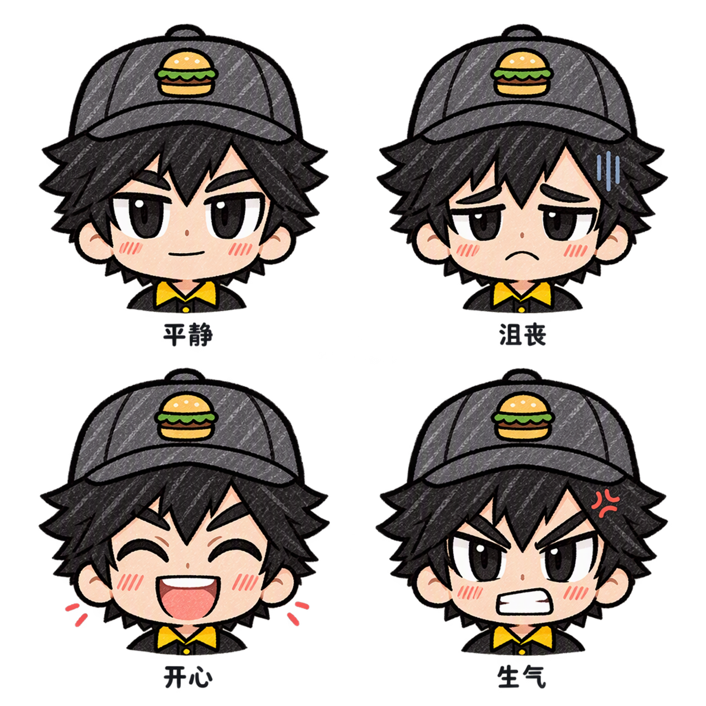

# 员工正面面部表情特写

2026-10-16。根据当前员工三视图的正面形象，使用Tap制造edit_image生成四格近景。

排列顺序：左上平静、右上沮丧、左下开心、右下生气。保持黑发黑瞳、深灰帽、汉堡徽章、黑黄制服领口与手绘彩铅风格，主要变化为眉眼嘴和少量情绪线。无手部道具。

2048×2048透明PNG，RGBA透明度0–255；已查看四格完整画面。完整提示词、远端来源和平台结果存于资源同名maker-result.json。实际扣费及当前余额平台未返回，不估算。仅生成表情设定图，未接入游戏或提交构建。
