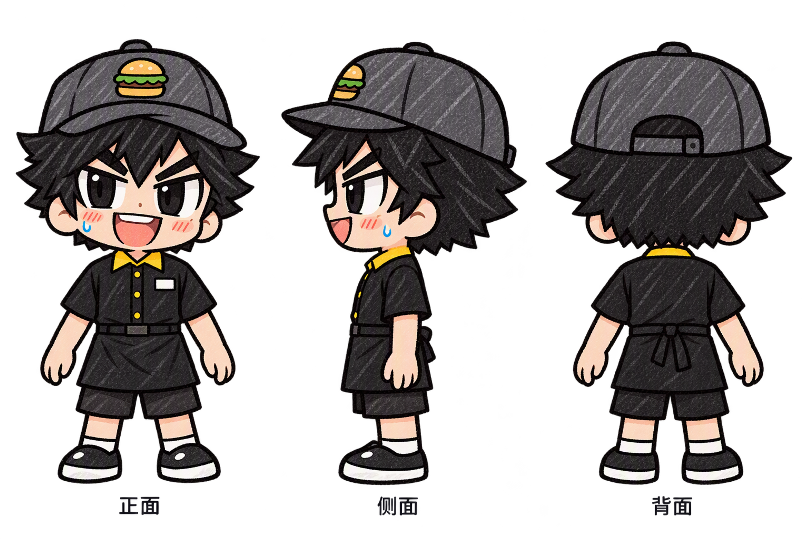

# 汉堡店员工无道具三视图

2026-10-16。以V3为基准，通过Tap制造edit_image生成。

从左至右为正面、朝画面左侧的侧面、背面。去除煎铲、餐盘和汉堡，双手空手自然放下；保留黑发黑瞳、深灰帽、黑黄制服与手绘彩铅风格。帽子前面的汉堡徽章作为服饰图案保留；背面补全帽子调节带与围裙系结。

实际3072×2048，RGBA透明度0–255，已检查完整画面和透明通道。原V3立绘保留。完整编辑提示词、远端来源和结果保存于同名maker-result.json。实际积分和余额平台未返回；只新增角色设定图，未接入游戏或提交构建。
