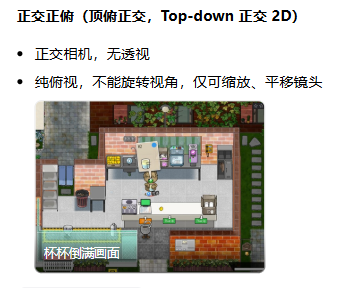
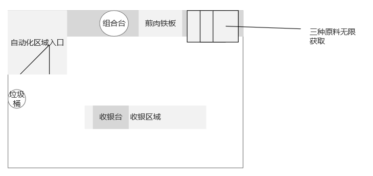

# Phase 1 · 镜头与地图参考确认

日期：2026-10-14。依据：用户要求镜头按图 1、地图位置按图 2 实现。本文件覆盖初版 Phase 1 的等轴测镜头和布局描述。

## 镜头

- 正交相机垂直向下，俯角 90°，水平角 0°，无透视远近缩放。
- 不允许旋转镜头。滚轮缩放，中键拖动平移；平移范围限制在房间附近。
- 屏幕右对应 +X，屏幕上对应 +Z，W/A/S/D 对应屏幕上/左/下/右。
- 保留基础几何体和物理系统，呈现为纯俯视平面白盒；不复制参考图的正式美术。

## 地图

房间保持 18×14 米、1 米网格。坐标原点位于房间中心；右为 +X，上为 +Z。图中相对位置和顺序为需求，以下尺寸为白盒实现参数，非图片像素的严格比例换算。

| 对象 | 位置（X，Z） | 占地宽×深 | 图中对应关系 |
| --- | --- | --- | --- |
| 自动化区域入口 | -6.7，4.2 | 4.4×5.5 | 左上预留入口区，可通行标记 |
| 手工组合台 | -0.9，5.8 | 3.2×1.8 | 顶边，铁板左侧 |
| 煎肉铁板 | 2.7，5.8 | 3×1.8 | 顶边，组合台右侧 |
| 汉堡胚原料点 | 5.3，5.8 | 1.25×1.8 | 右上三格原料中的左格 |
| 生牛肉原料点 | 6.65，5.8 | 1.25×1.8 | 右上中格 |
| 生菜原料点 | 8，5.8 | 1.25×1.8 | 右上右格 |
| 垃圾桶 | -8.1，-0.9 | 直径0.85 | 靠左墙，入口下方 |
| 收银台 | -1.2，-2.5 | 2.8×1.8 | 下方偏左 |
| 交付区域 | 2.95，-2.5 | 5.5×1.8 | 紧邻收银台右侧 |
| 玩家出生点 | 0，1 | — | 房间中间空地 |

三种原料点均为后续无限取料功能的固定位置，原料顺序采用汉堡胚、生牛肉、生菜。Phase 1 仍只做 F 目标检测。垃圾桶使用圆柱白盒，无物品销毁逻辑；入口使用地面标记，无传送或新房间。

## 验收变化

- 初版的 7 项运行自检证据不用于证明此次镜头和新地图已运行通过。
- 本轮增加纯俯视投影、顶部设备顺序、收银台与交付区相对位置检查，并适配新的交互点和碰撞位置。
- 本轮真实 Runtime 的 10 项自检已通过，日志记录 `COMPLETE failures=0`；最终操作版本关闭自动自检。运行证据见 [新版证据](phase1-layout-evidence.json)。
- 人工检查：镜头垂直俯视；鼠标不能旋转；滚轮缩放、中键拖动可用；三个原料标签不重叠；所有区域与参考布局一致。
- 自动化入口完整区域或垃圾处理玩法不在此次 Phase 1 调整中扩展；后续按阶段处理。
