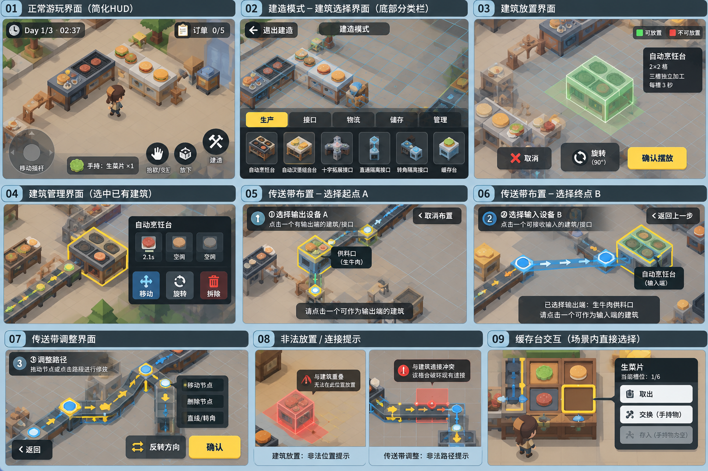

# 自动化汉堡店：下一阶段 UI 更新需求清单（已审阅补全）

日期：2026-10-18  
状态：用户已填写内容已核对，空白已补推荐；H01～H04已由用户确认，随后用户明确授权V0.3 UI开发；完成后提供人工验收清单。  
本轮产出：将概念板与修改建议转为可填写、可验收的需求；未修改游戏代码、镜头、比例、资源或预览。

## 1. 资料、填写方式与来源关系

本稿来源：

1. [用户提供的修改建议清单（原文归档）](references/ui-next-stage-20261018/自动化汉堡店建筑放置UI修改建议清单.md)。
2. [用户提供的九宫格 UI 概念板（原图归档）](references/ui-next-stage-20261018/自动化工厂游戏UI概念板.png)。
3. [当前画面与功能说明](current-game-ui-information.md)、[手机 UI 通用填写清单](mobile-ui-planning-checklist.md)，以及当前建筑/物流实现。

两份附件已原样复制归档，SHA256 与用户提供文件一致。附件是需求参考材料，其中的建议和图片示意不自动变成实施指令。

- 【原填】保留用户已填写原意；【审阅推荐】和【推荐】是补全方案，不伪装成用户已确认。
- “本轮安排”填：本轮制作 / 后续制作 / 不做 / 待定。
- 表中“整理方向”来自附件，仍可修改；“建议”不等于已确认。
- 当前统一规范见[UI默认布局与交互规范](ui-layout-defaults.md)。[用户原始填写版](references/ui-next-stage-20261018/user-filled-ui-requirements-before-review-20261018.md)已原样归档；历史通用模板不再作为平行待填写入口。
- 未明确的视觉元素不作为玩法变更依据；图片中的示例数字、文字和图标须绑定真实数据。

## 2. 更新目标与现有规则

附件表达的目标：场景为主体，通过模式切换、情境操作和信息分层组织 UI；借鉴工业建造界面的交互结构，不照搬其他作品的美术。

现有规则作为核对基线，改变时请填写第 3 节或第 12 节：

- 游戏需适配手机；Windows 键鼠操作继续保留。
- 当前镜头垂直俯视、正交、不旋转，场景比例保持。
- 保留现有生产、配方、运输、堵塞、环路校验、跨天与重开规则。
- 建筑投影固定与正式摆放分开；场景点选、拖动不直接建造。
- 建筑免费、无数量上限，没有金币、价格、等级、解锁、升级和玩家背包系统。
- 手持 1 件、缓存台 6 件、交付区 5 个汉堡独立；车间产出不自动交单。
- 缓存台不新增传统库存弹窗；选物期间产线继续，输出后进先出，选中失效需重新校验。
- 传送带采用建筑 A/B 选择和路径调整，不恢复旧设备列表、连接列表或全场启停功能。
- 当前仅基础传送带；节点调整不得借 UI 改版默认加入过滤、多带型或运行中改道。
- 衔接格后第一格的调整政策尚未确定；本次先整理受限状态反馈，不默认加入自动补线、自动重连或新的强制锁定算法。
- 建造、物流编辑、收银与缓存选择不暂停生产；暂停与结算冻结模拟。

本次整体目标补充：不使用美术风格，ui部分使用白模代替，优先完成整体游戏的ui架构。

## 3. 优先填写：概念板、建议清单与现有实现的差异

| 编号 | 差异/未定点 | 建议与可选方向 | 用户最终填写 |
| --- | --- | --- | --- |
| D01 | 概念板为斜视，现有游戏为垂直俯视 | 建议仅参考 UI 布局，不改镜头角度；若要改视角需单独明确范围 | 【原填】保持现有的垂直俯视，仅参考ui布局；【审阅推荐】保留现有垂直正交俯视和世界比例，只参考UI布局。 |
| D02 | 图片烹饪台标“2×2格”，当前烹饪/组合台为2.4×1.5米，缓存台为2×4格 | 建议显示真实占地，不为贴图示例改场景或碰撞；也可不在卡片显示尺寸 | 【原填】按照建议执行；【审阅推荐】卡片简述使用真实尺寸：烹饪/组合2.4×1.5米、缓存2×4格；不改模型或碰撞，详细说明移入暂停统计的设备说明分区。 |
| D03 | 建造时“适当拉高镜头”可能改变缩放与拖动体验 | 保持镜头 / 临时缩小视图且退出恢复 / 其他；俯角不随此项默认改变 | 【原填】应用建议；【审阅推荐】按后文进入/退出恢复的明确填写，推荐进入建造保存一次相机快照，临时缩放为进入前×0.9并限制在现有0.8～2.5；退出恢复，子模式不重复缩放。 |
| D04 | “订单0/5”含义不明确 | 建议表示当前待处理订单数/上限5，明确标签；不要与完成订单数、交付库存混用 | 【原填】应用建议；【审阅推荐】【H02用户确认】正常右上常驻待处理订单n/5，n为未完成订单条数，不是完成量或库存；点击展开可选单，交付只在收银。 |
| D05 | 概念图选“生产”却同时画出全部六类建筑 | 建议按文字清单分生产/接口/物流/储存/管理；各分类是否只显示所属项 | 【原填】应用建议；【审阅推荐】生产仅两种设备，接口仅三种接口，物流仅基础带，储存仅缓存台，管理显示管理入口卡；默认生产，不记忆上次分类。 |
| D06 | 图07有“删除节点”“直线/转角”，文字清单要求简化工具栏 | 建议本轮先不加入这两项；若要做需补节点可删范围、重连和形状调整规则 | 【原填】先不添加；【审阅推荐】不做删除节点、直线/转角按钮；仍保留原节点/路段调整和自动化简，不借UI改版增加算法功能。 |
| D07 | 图09有取出/交换/存入按钮，文字清单写直接点击槽，当前点击槽直接执行 | 选槽后点情境动作按钮 / 点槽直接执行 / 其他；手机与Windows是否一致 | 【原填】情景动作按钮；【审阅推荐】手机与Windows统一先点槽选择，再点右下唯一情境动作按钮；首次交互和点槽均不转移物品，成功退出选物。 |
| D08 | 图09的选槽、物品名称、编号为示例，可能不对应；缓存台图也可能只露出部分槽位 | 正式始终显示6槽，名称、编号、按钮状态必须与同一有效选中槽一致 | 【原填】应用建议；【审阅推荐】台面六槽及选中槽物品名、编号、动作同步；物品被产线取走后清除有效选择、禁用动作并要求重选。 |
| D09 | 图04管理动作在右侧卡片，文字清单要求底部工具栏 | 右侧卡片含动作 / 卡片仅信息+底部动作 / 其他；不能重复两套主按钮 | 【原填】卡片仅信息+底部动作；【审阅推荐】建筑附近信息卡只含名称与逐行状态；动作在右下统一工具区，返回/取消只在左上导航位。 |
| D10 | 当前点建筑即进入处理/移动；建议改为先选中再点“移动”等动作 | 新增只选中状态后显式操作 / 保留直接移动 / 其他 | 【原填】新增只选中状态后显式操作；【审阅推荐】点建筑先只选中，再点移动/旋转进入投影态；仅合法确认后修改真实建筑，取消保留原位置/朝向/库存。 |
| D11 | 当前摆放需确认按钮选中；附件希望统一确认，手机无鼠标悬停 | 建议正式动作统一由专用按钮完成，需明确一次点击是否直接执行；缓存等即时交互单独约定，不默认全局二次确认 | 【原填】应用建议；【审阅推荐】专用主按钮一次完整点击执行；按下不执行，松开需仍在热区且未形成拖动。键盘选中按钮后F/Enter同门槛执行；不要求手机先悬停或额外点击选按钮。 |
| D12 | 文字要求正常HUD有暂停，图01未明确显示暂停；奔跑控制也未画出 | 补充暂停位置、奔跑触发；不要因图未画就删除原功能 | 【原填】强烈同意，不要因为没有说明就删除原有功能。电脑操作奔跑可按shift，手机界面奔跑根据摇杆的移动程度来切换移动与奔跑；【审阅推荐】保留全部既有操作；右上暂停，电脑Shift奔跑，手机摇杆外圈奔跑。推荐死区15%，85%进入奔跑、75%退出，仍为4/8m/s。 |
| D13 | 自动设备详情“靠近显示”和“选中显示”条件未定 | 维持靠近且面朝 / 仅靠近 / 点选 / 管理选中；明确哪个条件优先 | 【原填】为我进行优先级设计，按照正常状态优先。进入a阶段后不显示其他阶段信息；【审阅推荐】正常为默认基础模式；每次只允许当前模式的工具/卡片，生命周期遮罩优先。正常靠近且面朝才自动显示设备卡，同范围手动点选优先；选A不显示选B/调整/正常设备详情。详见统一规范第4节。 |
| D14 | 网格建议正常隐藏或极淡，建造编辑显示；建筑选择页图中也有网格 | 各模式显隐、颜色、间距和显示范围需明确，网格不是新五格放置限制 | 【原填】应用建议；【审阅推荐】正常和建造首页隐藏网格；建筑投影、管理选中/编辑、传送带A/B/调整显示当前区域网格与占用/冲突标记；不新增范围限制。 |
| D15 | 概念板有完整餐厅美术、角色、机器模型及图标 | UI结构改版 / 同时做图标与控件美术 / 同时换场景资产；建议先明确资产范围，避免默认整体换美术 | 【原填】不进行资产替换，本次ui更新仅使用白模替换。；【审阅推荐】本轮不替换场景/员工/正式美术，不调用生成；用中性灰白模面板、文字/简单形状占位和必要状态色。R15只排除正式美术，基础白模控件是R01～R14的组成。 |

## 4. 本轮范围与顺序

附件建议的开发批次可调整。第一批“正常 HUD”含手机操作入口，但摇杆等基础输入须在第 5 节明确是否同步实现。

| 编号 | 更新模块 | 图号 | 建议批次 | 本轮安排 | 优先级/备注 |
| --- | --- | --- | --- | --- | --- |
| R01 | 简化正常游玩HUD与订单摘要 | 图01 | 第一批 | 本轮制作（按用户R01～R14汇总） | 推荐第1批基础 |
| R02 | 手机基础操作区、建造/暂停入口 | 图01 | 第一批基础依赖 | 本轮制作（按用户R01～R14汇总） | 推荐第1批基础 |
| R03 | 建造模式顶栏、网格、底部分类建筑栏 | 图02 | 第一批 | 本轮制作（按用户R01～R14汇总） | 推荐第1批基础 |
| R04 | 建筑放置工具栏、投影和确认状态 | 图03 | 第一批 | 本轮制作（按用户R01～R14汇总） | 推荐第1批基础 |
| R05 | 建筑管理选中状态与工具栏 | 图04 | 第二批 | 本轮制作（按用户R01～R14汇总） | 推荐第2批整合 |
| R06 | 建筑情境状态卡 | 图03/04 | 第二批 | 本轮制作（按用户R01～R14汇总） | 推荐第2批整合 |
| R07 | 传送带选择输出 A | 图05 | 第一批 | 本轮制作（按用户R01～R14汇总） | 推荐第1批基础 |
| R08 | 传送带选择输入 B及跟随预览 | 图06 | 第一批 | 本轮制作（按用户R01～R14汇总） | 推荐第1批基础 |
| R09 | 传送带路径调整、控制点反馈、确认 | 图07 | 第一批 | 本轮制作（按用户R01～R14汇总） | 推荐第1批基础 |
| R10 | 建筑/线路异常与受限状态反馈 | 图08 | 第一批基础反馈，第二批统一 | 本轮制作（按用户R01～R14汇总） | 推荐第1批基础 |
| R11 | 缓存台场景选物与触屏动作 | 图09 | 第二批 | 本轮制作（按用户R01～R14汇总） | 推荐第2批整合 |
| R12 | 返回导航、模式切换、Toast统一 | 图02～09 | 第一批基础导航，第二批统一 | 本轮制作（按用户R01～R14汇总） | 推荐第1批基础 |
| R13 | 收银、暂停、每日结算、完成页改版 | 图中未展开 | 第三批 | 本轮制作（按用户R01～R14汇总） | 推荐第3批页面收尾 |
| R14 | 操作教学、触控/显示设置 | 图中未展开 | 第三批 | 本轮制作（按用户R01～R14汇总） | 推荐第3批页面收尾 |
| R15 | 正式界面美术/生成资产（基础白模控件归R01～R14） | 全图 | 按本轮风格范围 | 用户明确不做 | 不替换场景、不生成正式图标；白模基本控件不是被排除项。 |

本轮必做编号：R01～R14（用户明确汇总）；R01行的“1”解释为本轮制作，不用其覆盖汇总范围。
后续制作编号：无新增本轮以外模块；R01～R14按依赖分批开发、全部完成后统一验收（推荐排程）。
明确不做：R15正式美术/资产替换、节点删除/形状工具、运行中改线、自动补线、金币/背包/升级与完整游戏进度存档（H03用户确认本轮不要求）。
阶段完成标准：R01～R14白模UI和状态覆盖，Windows功能回归、以小米14/Android15为目标的触屏适配、真实数据核对及人工验收清单齐备；用户真机未测不得预填通过。

## 5. 手机平台与手势基础（跨模块共用）

| 决策项 | 待填写内容 | 建议/边界 |
| --- | --- | --- |
| 首发系统与真机 | 【原填】安卓；【审阅推荐】安卓横屏为用户已填；【H04用户确认】小米14、Android15为本轮验收目标；尚未实测，不据此推断最低Android系统或其他机型性能。 | Android/iOS、代表设备、最低适配范围 |
| 屏幕方向 | 【原填】横屏；【审阅推荐】安卓横屏；iOS/平板推荐不纳本轮。 | 建议横屏；不能仅凭横屏概念图视为已确认 |
| 设计尺寸及UI缩放 | 【原填】随屏幕适应，设置安全区；【审阅推荐】1280×720作线框参考，运行使用逻辑尺寸与安全区响应式；默认UI比例1.0，设置0.9～1.2。覆盖16:9/19.5:9/20:9布局，未声明真机通过。 | 安全区、长宽比、平板是否支持 |
| 正常游玩摇杆 | 【原填】设置中可切换，目前更新优先选择固定；【审阅推荐】默认固定左下，直径112逻辑单位、边距16，死区15%；设置切换浮动，保存UI偏好；施工/缓存/收银隐藏并禁角色移动。 | 固定/浮动、大小、死区、是否可换边 |
| 奔跑控制 | 【原填】摇杆外圈；【审阅推荐】电脑Shift；手机摇杆85%以上8m/s，回到75%以下4m/s，死区内停止，松手清奔跑，不新增连续变速。 | 按住/切换/摇杆外圈；保留2倍移速 |
| 情境交互按钮 | 【原填】进入操作阶段时候显示，电脑通过鼠标选取，手机通过触屏选择；【审阅推荐】统一右下；正常目标自动依据靠近且面朝，同范围显式点击/触摸可选目标；无有效目标灰，文案随物品/建筑/手持变化，操作仍校验原距离和遮挡。 | 何时显示/禁用，物品或建筑目标如何选择 |
| 手工铁板持续加工 | 【原填】新增互动按钮；【审阅推荐】复用右下情境按钮“按住加工”；持续3秒，松开/失焦/离开或条件失效按原规则清进度；电脑F继续可用，不改成点击自动加工。 | 如何触屏连续操作3秒；中断行为维持原规则，除非明确变更 |
| 放下按钮 | 【原填】无物品时按钮灰色，有物品时恢复原色，落点失败进行气泡提示；【审阅推荐】统一右下交互旁；空手灰，持物可用，失败F气泡约3秒；不消耗或复制物品。 | 手持为空的表现、落点失败反馈 |
| 普通场景镜头拖动 | 【原填】双指；【审阅推荐】双指从非UI/非摇杆区域开始，以中心位移平移；手指所有权不可抢占，编辑拖动未结束时不启动镜头手势。 | 单指空白/双指/其他，与摇杆区分 |
| 镜头缩放 | 【原填】应用建议；【审阅推荐】双指间距缩放，沿用0.8～2.5；不旋转，编辑模式可在结束物体拖动后缩放。建造临时缩放及退出恢复见D03。 | 双指捏合、上下限、复位；编辑中是否允许 |
| 建筑拖动与固定/解除 | 【原填】应用建议；【审阅推荐】先碰投影再拖，抓取偏移避免跳变，松手固定；点空白解除并重定位，不建造；虚实和状态词区分固定/跟随，绿红专门表达合法性。 | 点地面定位/拖投影/独立固定按钮；保留与正式摆放的区分 |
| 控制点拖动 | 【原填】先选再拖；【2026-10-18验收后修改】单段电脑/手机统一按住0.35秒后拖动，取消四向按钮；端点/角点仍先选再拖。松手不提交整带；热区≥48，端点/角点优先线段，同类最近优先。 | 先选再拖/直接拖、选取优先级、精确微调方案 |
| UI栏滑动 | 【原填】应用建议；【审阅推荐】横向滚动手势仅归底栏，超过8逻辑单位取消点击；不穿透场景或变成镜头/节点拖动。 | 横向滑动不选中建筑或穿透拖镜头 |
| 多点触控 | 【原填】为我给出初步建议；【审阅推荐】支持摇杆+点击交互/放下；镜头必须两个独立非UI触点，摇杆触点不计入。UI、摇杆、物体拖动、镜头分别持有触点；物体拖动与镜头互斥。 | 支持哪些同时操作；后触手指不能抢走其他控件的触摸 |
| 编辑模式角色移动 | 【原填】暂时透明角色，但是保留碰撞禁止建筑在此位置摆放，禁止角色移动；【审阅推荐】禁止移动、摇杆隐藏、角色模型约25%可见；碰撞和占位保留，建筑不得覆盖角色位置；手持信息仍保留H位。 | 当前施工期间角色停止；是否保留，摇杆隐藏还是禁用 |
| 系统返回/后台 | 【原填】应用建议；【审阅推荐】Android返回手势等同当前左上返回，Windows右键逐层、ESC按表；后台释放所有按住/拖动并暂停，恢复停暂停等待继续。H03已确认本轮不做游戏进度存档，退出结束运行，重新进入重新开始。 | Android返回手势、切后台暂停、恢复触摸状态；iOS有可见返回按钮 |
| Windows键鼠 | 【原填】应用建议，设置中可选择是否显示双端ui，默认显示双端ui；【审阅推荐】同一套按钮可触摸/点击并附键位标记，默认双端UI含摇杆；设置可切换键鼠/触屏/双端显示，完整键位说明只放设置，不堆HUD。 | 保留快捷键，提示随设备切换；是否需要同时显示两套入口 |

## 6. 图01～09逐项需求填写

### R01/R02：图01 正常游玩与操作入口

整理方向：时间在顶部，订单摘要在顶部，手持信息靠近操作区；左下摇杆，右侧交互/放下/建造，补齐暂停与奔跑。

| 填写项 | 用户填写 |
| --- | --- |
| 常驻HUD最终字段及位置 | 【原填】依照参考图1；【审阅推荐】T左上时间、O右上常驻待处理n/5摘要（H02已确认）、P最右暂停、H下方手持、J左下摇杆、A右下交互/放下/建造；正常无需冗余模式标题。 |
| 版本号、完整键盘说明、累计交接、今日产量、测试状态：分别删除/折叠/保留哪里 | 【原填】版本号显示在暂停界面屏幕右下角，完整键盘信息显示在设置界面，累计交接与今日产量显示在暂停页面的统计窗口，暂停页面新增统计窗口，显示详细数据信息。；【审阅推荐】依用户填写：版本在暂停右下，键位在设置，统计页放真实运行数字并分设备说明；正式HUD不常驻测试状态，无数据不显示虚构指标。 |
| 当前区域、车间进入/返回信息是否保留；放在哪里 | 【原填】保留，操作气泡显示，按照默认建筑交互规范；【审阅推荐】保留统一场景检查I位与操作气泡；入口显示目的地和情境动作，区域切换不误示为停止产线。 |
| 订单摘要文案、数字含义；展开/关闭方式与详情字段 | 【原填】订单极简显示，显示当前共计订单数目。点击展开，详细信息包含订单需求；【审阅推荐】推荐待处理n/5；展开编号、需求/已交付、有效选中项。H02已确认正常HUD常驻。展开不暂停，导航返回或非交互空白关闭且消费该触摸。 |
| 订单展开仅浏览，还是可选择；必须在收银台交付的限制是否保留 | 【原填】可选择，保留必须在收银台交付；【审阅推荐】可选择且选择只更新有效订单ID；不提供远程交付。进收银复用仍有效选择，订单消失清选，不能静默选另一单。 |
| 交付区库存在哪里显示，如何区别订单数 | 【原填】靠近交付区显示库存。订单数在收银台显示；【审阅推荐】交付区靠近检查显示“交付库存n/5”，收银显示可用库存；订单待处理条数与库存明确分开，H02已确认正常右上常驻订单摘要。 |
| 手持图标、名称、数量与空手状态 | 【原填】按照参考图设计；【审阅推荐】固定H位，空手文字或占位框；有物显示文字占位图形、名称×1；不新增背包图标和格子。 |
| 移动、奔跑、交互、放下、建造、暂停按钮位置及显隐 | 【原填】允许；【审阅推荐】按公共位置J/A/P：正常可见，奔跑由摇杆程度触发不另铺按钮；编辑仅保留本模式工具，无物放下灰；H01已确认移除店铺初始两台自动机；店铺不开放建筑首页或管理入口，手工生产保留。 |
| 交互目标变化时按钮动词和名称如何更新 | 【原填】即时更新；【审阅推荐】实时绑定有效目标与手持；同帧重新校验，目标失效按钮灰并清旧动作，避免用旧名称操作新物。 |
| 本模块验收操作与预期 | 【原填】人工验收，给我验收清单；【审阅推荐】按A01/A02/A17～A20逐项人工测试；含HUD、订单选择、手持、触屏长按、模式互斥和统计字段，当前未测。 |

### R03：图02 建造入口、分类栏与网格

建议分类：生产（烹饪/组合）、接口（十字/直通隔离/转角隔离）、物流（基础传送带）、储存（缓存台）、管理（已有建筑/带）。

| 填写项 | 用户填写 |
| --- | --- |
| 默认分类、分类切换、是否记忆上次选项 | 【原填】不记忆；【审阅推荐】每次进入默认生产，不记忆；点击分类切换所属卡；管理分类先展示入口卡。 |
| 底栏高度/占屏比例、卡片尺寸、横向滚动方式 | 【原填】为我推荐；【审阅推荐】选型栏默认128逻辑单位高，卡约112×72，分类热区≥44；横向滚动，短高屏先隐藏辅助文案而不缩小按钮热区。 |
| 卡片显示图标/名称/占地/用途哪些信息 | 【原填】为我推荐；【审阅推荐】白模文字占位图形、名称、真实占地一行；选中框明确，不放静态说明卡，详述到暂停统计设备说明。 |
| 点击卡片直接进入预览，还是先选中再确认 | 【原填】先选中再确认；【审阅推荐】点卡仅选中；右下“进入放置”进入预览，与最终“确认摆放”分两步。 |
| 店铺内不能建造的接口/缓存/传送带：隐藏还是禁用并说明 | 【原填】店铺内无法打开建筑界面；【审阅推荐】【H01用户确认】下一阶段移除店内auto_grill与auto_assembly，启动/重开均不再生成；不开放店铺建筑/管理入口。手工铁板、组合台及车间ws_cooker/ws_assembler保留。 |
| 管理分类点击后直接进入管理，还是先显示入口卡 | 【原填】先显示入口卡；【审阅推荐】先显示“已有建筑/传送带管理”入口卡，再由右下进入管理；不点分类立即改场景状态。 |
| 顶部“建造模式”、退出按钮位置 | 【原填】依据参考图；【审阅推荐】C顶部中央“建造模式”，L左上“退出建造”；右上P暂停始终在同一位置。 |
| 正常/选择/放置/管理/物流阶段：网格各自显隐、范围、透明度 | 【原填】有关建筑放置，拆除，移动，强化网格显示。其他情况默认隐藏网格显示；【审阅推荐】正常和选型隐藏；投影放置/移动、管理选中、物流A/B/调整显示当前区域，线透明度推荐25%，选中占地45%，冲突格60%；比例不变。 |
| 是否临时缩放镜头；进入/退出如何保存和恢复 | 【原填】进入建筑阶段进入，退出恢复；【审阅推荐】依用户进入后退出恢复：进入建造仅存一次位置/缩放，临时×0.9钳在0.8～2.5；子状态共享，退出建造恢复快照。 |
| 本模块验收操作与预期 | 【推荐】A03/A04/A10：分类隔离、先选卡再进预览、底栏滚动不穿透、网格显隐、退出还原镜头；店铺禁止建筑入口，店内两台自动机移除；手工与车间设备保留。 |

### R04：图03 建筑放置

整理方向：选择建筑后收起或弱化底栏；保留取消、旋转90°、确认摆放。建筑占地与颜色反馈使用当前真实数据。

| 填写项 | 用户填写 |
| --- | --- |
| 进入放置后底部分类栏隐藏还是弱化；是否保留重选入口 | 【原填】弱化，保留；【审阅推荐】弱化为约40逻辑单位选型条，保留更换建筑卡；动作工具在同一底部区域右侧，不再保留大菜单。 |
| “正在放置：建筑名”的位置；是否另有静态建筑说明卡 | 【原填】无需说明卡；【审阅推荐】C统一模式位显示名称；不增加静态说明卡。 |
| 说明卡字段：真实尺寸、用途、槽位、加工时间等 | 【原填】说明卡内容放入 暂停界面-统计 内；【审阅推荐】暂停→统计内“设备说明”分区显示真实参数；与“运行统计”分区分开，图示尺寸不覆盖数据。 |
| 取消、旋转、确认按钮位置与尺寸 | 【原填】较小尺寸，不要遮盖大部分信息，位置贴合底部分类栏；【审阅推荐】为满足后文全局左上返回规范，取消统一L，底部A旋转48×48、确认约104×48；卡条紧贴底部，热区不小于48。 |
| 跟随/固定状态如何表达、切换；手指与投影的偏移规则 | 【原填】通过颜色区分，跟随状态为虚影。手指触碰投影进行偏移；【审阅推荐】跟随用低透明虚影+“跟随”，松手固定用实线框+“已固定”；合法性另用绿/红。抓取偏移防跳变，落点标记高于手指32，不改变实际网格坐标。 |
| 绿色合法/红色非法、占地格、冲突格与图标样式 | 【原填】绿色合法，红色非法，通过颜色区分是否合法；【审阅推荐】保持绿合法红非法，同时显示可/不可放置与具体原因，避免只靠颜色；冲突位置单独高亮。 |
| 确认何时可用、非法何时禁用；失败原因常显位置 | 【原填】是；【审阅推荐】仅有效投影且通过占地/对象/加工/连接检查时启用；否则灰，原因F位常显，不依赖点击禁用按钮获取。 |
| 连续摆放后位置、旋转和固定状态如何保留 | 【原填】是；【审阅推荐】保留种类、朝向及同位置固定预览；刚放完重叠则红且不可连点重复建，拖到新位置后恢复。成功不退出放置。 |
| 取消退回选型还是退出建造；分别提供哪些按钮 | 【原填】退回选型；【审阅推荐】L取消当前预览回选型，选型L退出建造；不同时摆两套取消，Windows右键逐层、ESC回建筑首页。 |
| 本模块验收操作与预期 | 【推荐】A04/A09/A12：合法/非法、固定与建造分离、单次确认、连续摆放不重复、取消不留实体、角色占位保护。 |

### R05/R06：图04 建筑管理与情境详情

整理方向：先在场景点选建筑并高亮，显示小型卡片和操作工具；移动、旋转、拆除、返回有可见入口，不新增大型管理窗。

| 填写项 | 用户填写 |
| --- | --- |
| 管理中点击建筑是否只选中；点击空白是否取消选中 | 【原填】是；【审阅推荐】点击只选中，点空白取消选择回管理未选中；尚无投影时不移动真实建筑。 |
| 选中高亮样式、多个建筑密集时的选择辅助 | 【原填】是；【审阅推荐】外框+已选文字；选屏幕命中范围最近对象，同距优先当前选择，提供再次点选循环重叠候选的小范围辅助，不全图列表。 |
| 信息卡锚点：建筑附近/右侧/其他；靠近屏幕边缘如何避让 | 【原填】建筑附近，避让；【审阅推荐】统一I场景信息位，建筑边框上方优先，越安全边界换到另一侧；动作不进入信息卡。 |
| 移动/旋转/拆除/返回工具位置；与详情卡是否分开 | 【原填】是；【审阅推荐】详情I、动作A分开；移动/旋转与拆除间隔≥24，返回只有L，不在卡内再放一套动作。 |
| 移动与旋转如何预览、确认和取消；原状态何时实际写入 | 【原填】预览进入投影态，确认和取消遵守投影阶段规则。 未明确原状态写入意思；【审阅推荐】“写入”即真正修改原建筑位置/朝向：进入编辑先只改投影，真实建筑和内部物保持原状；合法确认才一次写入，取消不改；旋转也先预览再确认。 |
| 已接带、加工中、固定建筑等不可操作情况如何禁用/解释 | 【原填】禁止操作交互，提示为相关禁止原因；【审阅推荐】沿现有规则禁用有关动作并在F显示真实原因；只限制相关按钮，不关闭只读检查；不能删除的固定对象无拆除入口。 |
| 整条带选中时显示什么，是否只提供拆除和返回 | 【原填】是；【审阅推荐】I显示带编号、A→B、长度/在途数量等真实值；A只拆除，L返回；不提供运行中改线/改向。 |
| 拆除防误触：间距/长按/确认/其他；只选择明确需要的方式 | 【原填】间隔0.5s，图标由灰复原；【审阅推荐】依用户0.5秒灰转可用：新选对象后0.5秒才解锁，拆后全局冷却0.5秒；原业务限制没解除继续灰。不默认新增长按或第二确认弹窗。 |
| 拆除成功继续管理、损失内容/数量如何显示及保留多久 | 【原填】2s，有推荐优先推荐时长；【审阅推荐】成功清选择留管理；普通成功2秒，实际损失至少4秒，完整种类/数量留本局暂停统计，不被普通成功覆盖。 |
| 自动烹饪台详情：三个槽、剩余时间、熟肉待取如何呈现 | 【原填】文字呈现，无需图片。依次排列；【审阅推荐】I纯文字依次三行：槽1/2/3、空/生肉剩余秒/熟肉待取；不生成图标或图片。 |
| 自动组合台详情：三种材料、2秒加工、成品1件如何呈现 | 【原填】文字呈现，无需图片。依次排列；【审阅推荐】I纯文字列胚/熟肉/菜的0/1，状态行等待/剩余秒/汉堡1件待取；错误生肉按实际状态解释。 |
| 正常游玩与管理模式下，靠近/面朝/点选显示条件及隐藏条件 | 【原填】为我推荐；【审阅推荐】正常默认靠近且面朝当前目标；同范围显式点选优先，移动或失效解除。管理只看选中对象，不混入正常自动目标卡；离开该模式关闭。 |
| 原左上手工生产状态迁移到哪里，避免精简HUD后信息丢失 | 【原填】取消生产状态，生产状态并入建筑检查内容；【审阅推荐】取消常驻文字，手工生产状态进入同一I建筑检查卡，保留长按加工与材料/成品状态，不删除生产功能。 |
| 本模块验收操作与预期 | 【推荐】A05/A06/A15/A17：只选不移动、原状态确认写入/取消恢复、限制说明、三槽和组合文字真实、0.5秒防误触、损失可读。 |

### R07/R08：图05/06 传送带选择 A/B

整理方向：顶部明确阶段；A是输出建筑，B是输入建筑。选A后保持A标识，选B期间路径持续跟随当前位置。

| 填写项 | 用户填写 |
| --- | --- |
| 阶段标题、步骤数字、已选对象名称的位置 | 【原填】所有信息内容默认显示位置，尽可能统一显示状态；【审阅推荐】统一C模式位，1/3选输出A、2/3选输入B并显示A名；场景I只显示本阶段目标角色，不显示设备生产详情。 |
| 可选目标高亮：全部候选常亮/触摸附近/点选后反馈 | 【原填】为我推荐；【审阅推荐】当前阶段能力合格候选用淡轮廓，触摸命中用实轮廓+名称；已选A持续高亮，避免整屏强闪烁。 |
| “可输出/可输入”候选范围：能力、端口占用、拓扑条件如何区分 | 【原填】为我推荐；【审阅推荐】先按同区和输入/输出能力筛候选；端口全占或形成闭环等点选时解释并阻止推进。仅空间无合法路径不排除B，仍进入可编辑红预览。 |
| 不可连接对象：不显示候选/点后解释/其他；无合法路线仍保留可编辑非法预览 | 【原填】为我推荐；【审阅推荐】不作有效候选高亮，点击只解释真实原因；空白不推进。能力/端口/拓扑非法不确认B，纯占地无路保留原非法预览编辑流程。 |
| 手机点对象立即选定，还是高亮后独立确认 | 【推荐】点有效建筑一次即推进A/B阶段；不增加一套端点确认按钮，只有最终线路需专用确认。手机与鼠标一致。 |
| 选B时路径跟随手指/点地面光标/其他；离手后停在哪里 | 【推荐】鼠标跟随当前光标；手机场景触点移动跟随网格光标，离手停末格。超过拖阈值的松手不当点选B；未拖动点有效B才推进。 |
| A保持高亮、B悬停/选中反馈和端口方向标识 | 【推荐】A持续外框+输出A；本阶段候选/命中B显示输入B；端口用方向箭头和角色文字，不依赖仅颜色区分。 |
| 点空白保留选B；再次点A如何处理 | 【推荐】点空白只改当前光标/预览且仍选B；再点A提示不能连接自身，不隐式清A，返回L才回选A。 |
| 取消布置与返回上一步的按钮位置、含义 | 【原填】所有回退按钮，退出按钮，均遵守左上角位置。采取统一形态。；【审阅推荐】全部统一L左上同样式。选A显示取消布置→建造首页，选B返回→选A；不在底部重复返回。 |
| 完成一条带后进入下一轮选A，是否显示成功提示及保留镜头 | 【推荐】成功2秒反馈，清本条A/B、预览、编辑状态，进入下一轮选A并保留当前建造镜头，退出建造才恢复入场快照。 |
| 本模块验收操作与预期 | 【推荐】A07/A10/A12：三阶段互斥、A保持、B跟随、拖动与点击区分、无路可编辑红预览、无效目标解释、连续布线。 |

### R09：图07 传送带调整

整理方向：在场景直接操作端点、角点、直线路段；区分未选中、选中、可移动、受限、非法。工具栏优先只保留反转、确认、返回。

| 填写项 | 用户填写 |
| --- | --- |
| 节点/路段的外观、命中范围和选取优先级 | 【推荐】端点圆/角点方/线段中点短条白模；最小48触区，角点和端点优先线段，同类按屏幕最近，选中实框、未选空框。 |
| 点击选中与拖动编辑的步骤；松手结束还是需另点完成 | 【已修改】单段静止按住0.35秒后拖动，提前移动超过8逻辑单位取消本次长按；端点/转角先点选再拖。松手仅结束局部编辑，不摆整带。WASD空间选择保留，F与WASD编辑仅用于端点/转角，专用主确认才落地。 |
| 可移动方向如何表达，受限点反馈如何表达 | 【已修改】选中框与底部操作提示，不显示四向按钮；试算位移受限显示标志+原因，绿红仍只表达合法性；不把第一衔接邻格新增为一律硬锁，不补线/重连。 |
| 精确调整：四向微调/局部放大/仅拖动/其他 | 【已修改】无四向微调按钮；单段仅长按拖动，沿用网格吸附和不可变编辑快照。端点/转角保留原键盘逐格编辑；不额外新增局部放大窗，结束拖动后可用双指全局缩放。 |
| 反转方向、确认、返回的位置；是否有独立取消整条布置入口 | 【推荐】A右下反转、最右确认；L返回选B。取消整条按层返回到选A再取消，不同时加底部返回/退出。 |
| “基础带”仅作说明还是隐藏；不出现虚构的多类型切换 | 【推荐】隐藏类型切换按钮，基础带/0.5格每秒等只在暂停统计设备说明中查阅。 |
| 图中“删除节点”“直线/转角”是否纳入；若纳入填写下方附加模板 | 【推荐】不纳入，本节附加模板标为本轮不适用。 |
| 非法确认禁用、方向箭头、冲突点、原因如何联动 | 【推荐】每次预览重算同步更新颜色/方向/冲突标记/首要原因；非法确认灰，修正后恢复，不能按钮状态滞后一帧误落地。 |
| 按钮点击与场景编辑、镜头拖动的冲突优先级 | 【推荐】导航/UI优先，其次已持有的对象拖动，再场景选取；镜头须两独立非UI触点且无对象拖动，按钮事件消费触摸不穿透。 |
| 本模块验收操作与预期（含直线/L形/U形及反向调整） | 【推荐】A08/A09/A10/A12：鼠标/触屏/键盘各测直线L/U、端点贴边、角点联动、反向恢复、单段长按与提前移动取消、端点/转角键盘编辑、受限提示、非法禁确认；不自动补线。 |

仅当明确新增“删除节点”或“直线/转角”时填写：

- 功能名称及解决的问题：【推荐】本轮不适用：用户D06明确不新增节点删除/直线转角工具。
- 可作用的节点/路段，是否允许作用于端点：【推荐】本轮不适用，沿用既有节点/路段调整。
- 修改后如何保持建筑连接、网格直角、无环路、无重叠：【推荐】本轮不适用新增工具；既有路径仍严格校验连接、网格、闭环与占地。
- 无法完成时如何保留原状态并提示：【推荐】不适用新增工具；预览失败保留真实实体，提示当前原因。
- 对已放置、运行中传送带是否开放：【推荐】不开放运行中改向/改线，保持原规则。
- 独立验收标准：【推荐】本轮不新增该功能，A08验证没有误加工具。

### R10：图08 非法位置、线路与受限反馈

| 状态 | 场景表现填写 | 简短原因文案填写 | 按钮/操作状态填写 |
| --- | --- | --- | --- |
| 合法建筑/路径 | 【推荐】绿+可放置，保留方向与占地标记 | 【推荐】可放置 | 【推荐】有效预览确认可用 |
| 与建筑重叠 | 【推荐】冲突建筑占格红，其他段仍显示轮廓 | 【推荐】与建筑重叠 | 【推荐】确认灰，可继续调整 |
| 与传送带重叠/堆叠 | 【推荐】重叠格/段红并标记交点 | 【推荐】与传送带重叠 | 【推荐】确认灰，不允许堆叠 |
| 越界/入口预留区 | 【推荐】越界/保留格红，边界线强调 | 【推荐】超出区域 / 占用入口预留区（按真实原因） | 【推荐】确认灰，不新增五格限制 |
| 端口占用或建筑能力不支持 | 【推荐】端口标记红+角色字样 | 【推荐】端口已占用 / 该建筑不支持输入或输出 | 【推荐】不推进无效B，已有调整非法则确认灰 |
| 自连/跨区/形成闭环 | 【推荐】相关端点/闭合段红 | 【推荐】不能自连 / 不支持跨区 / 禁止闭环 | 【推荐】阻止对应确认，不改变旧实体网络 |
| 无法保持衔接、拖动受限 | 【推荐】选中点受限标志+尝试方向 | 【推荐】无法保持连接，请调整其他节点 | 【推荐】局部操作不写实体；整条是否可确认按最终实际预览合法性，不一律判整带非法 |
| 加工中无法拆移/已接带无法移动 | 【推荐】选中轮廓保留，相关动作灰 | 【推荐】加工中不能拆移 / 请先拆除相连传送带 | 【推荐】相关动作禁用，检查和返回仍可用 |
| 暂无合法路线的初始预览 | 【推荐】显示完整可编辑红预览和具体冲突格 | 【推荐】暂无合法路径，请手动调整 | 【推荐】确认灰，端点/转角可选后拖动，单段可长按拖动 |

- 多种原因同时出现时的优先级：【推荐】对象失效/模式限制→越界/跨区→端口能力占用/闭环→建筑重叠→带重叠→衔接受限；按实际校验原因解释，见布局规范第6节。
- 提示贴近冲突位置还是屏幕固定；屏幕边缘/手指遮挡处理：【推荐】冲突格就地标记，首要原因统一F；I卡贴边换侧，重要按钮不被遮。
- 禁用按钮仍能理解原因的方式：【推荐】原因在F持续显示并与被禁用动作关联，不依赖点击灰按钮或鼠标悬停。
- 本模块验收操作与预期：【推荐】按A09，逐类制造真实非法场景，核对颜色/位置/文案/按钮状态同帧一致，修正后恢复。

### R11：图09 缓存台交互

整理方向：六槽保留在场景本体，选槽高亮；如果需要操作卡，只用于当前槽位，不变成独立背包或库存窗口。

| 填写项 | 用户填写 |
| --- | --- |
| 第一次交互如何进入选物；是否保留距离/面朝条件 | 【推荐】正常靠近且面朝缓存台，右下情境交互进入选物，首进只选槽不转移，保留原操作距离和角色停止规则。 |
| 点槽立即执行，还是先选槽再点动作按钮（对应D07） | 【推荐】按用户D07：台面点槽只更新选择，右下唯一情境按钮执行；鼠标和手机一致，键盘选槽后F执行同一校验。 |
| 当前槽编号、物品名、空槽文案及卡片位置 | 【推荐】I位置显示物品名或空、槽n/6，与台面选中高亮绑定；不复制六槽到额外库存弹窗。 |
| 只显示当前可执行的一个动作，还是显示三个动作并禁用其他 | 【推荐】只显示唯一匹配动作：取出/交换/存入；空手空槽显示灰“空槽”；无效选择灰“请重新选择”，不铺三个重复按钮。 |
| 手持物与当前槽内容变化时，如何及时更新动作 | 【推荐】实时重读槽位与手持，用物品稳定ID校验后再执行；只更新显示不能让旧确认作用于新物。 |
| 选中物被输出带取走后的高亮、按钮禁用和重选提示 | 【推荐】移除有效选中强调，动作禁用，Toast“物品已被输出，请重新选择”；不自动选择顶替物，用户重新点槽/键盘移动后才能确认。 |
| 成功后退出选物还是保持；若改现有行为需明确 | 【推荐】保留原成功退出选择，回正常，生产不中断。 |
| 取消/返回入口，台面槽触摸热区和边缘避让 | 【推荐】L取消选物回正常，右键/ESC同义；每槽触区尽量48且不互盖，过密时需镜头放大/按最近槽命中，不能把6槽变背包。 |
| 本模块验收操作与预期 | 【推荐】A11/A12：六槽四种手持矩阵、首次不取物、点槽不执行、明确按钮执行、产线并发选择失效、成功退出、返回不丢物。 |

必须校验的动作矩阵：

| 手持状态 | 槽位状态 | 有效动作 | 用户补充/修改 |
| --- | --- | --- | --- |
| 空手 | 有物 | 取出 | 【推荐】保留本行动作矩阵；动作按钮执行前验证当前选择，成功退出，无效或空手空槽不转移。 |
| 有物 | 有物 | 交换 | 【推荐】保留本行动作矩阵；动作按钮执行前验证当前选择，成功退出，无效或空手空槽不转移。 |
| 有物 | 空槽 | 存入 | 【推荐】保留本行动作矩阵；动作按钮执行前验证当前选择，成功退出，无效或空手空槽不转移。 |
| 空手 | 空槽 | 不转移物品，提示为空 | 【推荐】保留本行动作矩阵；动作按钮执行前验证当前选择，成功退出，无效或空手空槽不转移。 |
| 任意 | 选中已失效 | 阻止旧选择操作，重新选择 | 【推荐】保留本行动作矩阵；动作按钮执行前验证当前选择，成功退出，无效或空手空槽不转移。 |

## 7. R12 返回、确认及模式切换

“返回上一步”“取消当前布置”“退出建造”含义分别填写，不能用同一图标表达多个不明确结果。

| 当前状态 | 手机返回按钮去向 | 取消/退出入口 | Windows右键 | Windows ESC |
| --- | --- | --- | --- | --- |
| 正常游玩 | 【推荐】默认不出现返回键；Android返回进入暂停 | 【推荐】P右上暂停，退出在暂停内 | 【推荐】不改变正常交互 | 【推荐】暂停 |
| 建造首页/选型 | 【推荐】L退出建造→正常 | 【推荐】仅L，不重复底部退出 | 【推荐】退出建造 | 【推荐】退出建造 |
| 建筑放置 | 【推荐】L取消放置→选型 | 【推荐】L同一按钮 | 【推荐】返回选型 | 【推荐】建筑首页 |
| 建筑管理未选中 | 【推荐】L返回选型 | 【推荐】选型再L退出建造 | 【推荐】返回选型 | 【推荐】建筑首页 |
| 建筑管理选中/编辑 | 【推荐】选中时L取消选择→未选中；投影编辑L取消→原选中 | 【推荐】沿同一L逐层退出 | 【推荐】与L逐层相同 | 【推荐】建筑首页，丢弃未确认投影 |
| 传送带选A | 【推荐】L取消布置→建造首页 | 【推荐】L同义 | 【推荐】建造首页 | 【推荐】建筑首页 |
| 传送带选B | 【推荐】L返回→选A | 【推荐】继续按L至选A再取消 | 【推荐】选A | 【推荐】建筑首页 |
| 传送带调整 | 【推荐】L返回→选B | 【推荐】继续按L逐层取消整条 | 【推荐】选B | 【推荐】建筑首页 |
| 缓存台选物 | 【推荐】L取消选物→正常 | 【推荐】L同义 | 【推荐】取消选物 | 【推荐】取消选物 |
| 订单摘要展开 | 【推荐】L关闭常驻订单摘要的展开页→正常 | 【推荐】非交互空白也可关闭并消费触摸 | 【推荐】关闭摘要 | 【推荐】先关闭摘要，不穿透暂停 |

确认动作填写：

- 建筑正式摆放：【推荐】专用确认按钮一次完整点击，非法禁用，快捷键走同门槛；不在场景点选时写实体。
- 建筑移动/旋转写入：【推荐】仅合法确认后一次改变原建筑坐标/朝向，取消不改真实实体。
- 传送带正式摆放：【推荐】专用确认一次完整点击；成功进入新选A，非法不落地。
- 拆除是否额外确认：【推荐】按用户选择0.5秒灰→可用和危险间距，不另加拆除二次确认或长按；损失真实提示。
- 缓存取出/交换/存入：【推荐】先点槽选择，再点唯一动作一次执行；执行前稳定ID/手持二次校验。
- 订单摘要浏览与收银交付的区别：【推荐】摘要可选单但不交单；收银复用有效已选单，交付只在收银。H02已确认摘要常驻正常HUD。
- 模式切换时清除哪些选择/预览、保留哪些状态：【推荐】清旧目标卡/候选/拖动，取消未确认预览；保留真实库存/生产/有效订单选择；暂停只释放触摸、保留原模式预览，继续不恢复旧按住。

## 8. 提示信息与公共视觉规范

| 项目 | 整理方向 | 用户最终填写 |
| --- | --- | --- |
| 模式信息 | 顶部显示正常/建造/管理/选A/选B/调整等状态 | 【推荐】C顶部中央唯一当前模式；正常默认不显示冗余模式名；其他模式内容不混入。 |
| 对象信息 | 场景附近显示名称、设备状态、槽位或已选对象 | 【推荐】I建筑附近一张文字信息卡，真实世界锚点投影，边缘换边；卡内不重复操作按钮。 |
| 操作信息 | 底部/右下显示当前模式少量高频按钮 | 【推荐】A右下唯一主动作最右、工具其左；返回/取消/退出统一L，普通与施工工具互斥。 |
| 短时反馈 | 中下方Toast显示成功、失败、空间不足、选择失效 | 【推荐】F中下方、底部工具上方至少12；成功2秒、失败/受限3秒；去重合并，手指遮挡时移动位置而不覆盖确认。 |
| 重要损失反馈 | 拆除真实损失种类/数量清楚可读，不被普通Toast立刻覆盖 | 【推荐】至少4秒，实际物品与数量，优先于普通成功，完整事件留本局暂停统计，重开清空，不承诺退出后持久化。 |
| 建筑昵称 | 保持建筑坐标锚定，避免与情境卡重复、随镜头漂移 | 【推荐】保持建筑坐标锚定；情境卡出现时卡头复用名称不另叠相同昵称，离开目标/换模式隐藏，避免随镜头漂移。 |
| 配色和风格 | 概念图深色半透明面板、黄色主动作仅为参考；填写最终颜色与风格 | 【推荐】按用户白模：中性灰、文字/简单形状占位；绿红仅状态并辅文字，选中用边框，不生成正式图标或替换场景美术。 |
| 字号/图标/热区 | 统一层级；主要热区建议至少约44～48逻辑像素，不能直接以整张九宫格像素定手机尺寸 | 【推荐】标题22正文18辅助16逻辑单位；热区≥48、间距12、危险间距≥24；短高屏折叠辅助信息/内部滚动，绝不按九宫格截图像素直接缩放按钮。 |
| 按钮状态 | 普通、选中、按下、禁用；手机无悬停依赖 | 【推荐】可用、选中、按下、禁用（灰+原因）；一次完整点击执行，触点离开或形成滚动不执行，手机不依赖hover。 |
| 防误触 | 确认/取消/拆除保持间距，UI不穿透场景，触摸中断释放操作 | 【推荐】UI触摸独占不穿透，模式切换清旧拖动；摇杆/双指镜头/对象拖动分所有权；拆除0.5秒门槛，长按加工条件失效取消。 |
| 遮挡与适配 | 避开手指、安全区和其他面板；设备卡贴边时可重定位 | 【推荐】扣除安全区，I卡边缘换边，落点标记在手指上方，A/L不被提示覆盖；UI缩放优先滚动/折叠。 |
| 资源范围 | 字体、按钮、图标、动效分别列明；场景模型和员工美术是否另行安排 | 【推荐】不生成或替换正式资产；复用现有字体，用白模面板、文字与简单形状构成公共控件，归R01～R14基础工作。 |

正式进入制作前，资源需求请写明用途与数量；普通工程用LOCAL，平台专属工具用MAKER-FREE，高价值生成任务才按积分规则使用MAKER-POINTS。本次未调用生成能力。

## 9. R13/R14 后续页面（本轮选做时填写）

| 项目 | 是否本轮 | 显示内容与动作补充 | 验收标准 |
| --- | --- | --- | --- |
| 收银页面 | 【推荐细则】本轮制作（用户R13） | 【推荐细则】中央M订单列表、已选项/交付库存，右下主交付；L关闭。仅收银交付，结束当天归零启用。 | 【推荐细则】选单、部分交付、库存空/订单失效禁用、计时归零与返回无穿透；未测 |
| 暂停页面 | 【推荐细则】本轮制作（用户R13） | 【推荐细则】M继续/结束当天/统计/设置/退出，右下角版本号；L继续。统计设运行数字与设备说明分区。 | 【推荐细则】暂停冻结、统计数字对账、子页回暂停、继续恢复原模式；手机退出结束本次运行且不保存游戏进度；未测 |
| 每日结算 | 【推荐细则】本轮制作（用户R13） | 【推荐细则】M当日订单和制作数/手工自动分项/提前结束说明；主按钮下一天或第三天查看完成。 | 【推荐细则】提前结束与归零结束统计一致，原跨天保留不变，无返回旧运行入口；未测 |
| Demo完成 | 【推荐细则】本轮制作（用户R13） | 【推荐细则】M三天真实统计，重新开始/退出；重开二次确认复用小面板。 | 【推荐细则】第三天完成、重开初始布局及空动态状态、返回与退出语义；H03已确认不要求进度存档；未测 |
| 触屏教学 | 【推荐细则】本轮制作（用户R14） | 【推荐细则】正常/放置/布线首次轻提示，同一时间仅当前阶段一条，可关闭及设置重看；不额外自动暂停。 | 【推荐细则】不遮主按钮、不串阶段、已读偏好/重置有效，不改变游戏进度；未测 |
| 触控/显示设置 | 【推荐细则】本轮制作（用户R14） | 【推荐细则】固定/浮动摇杆、双端/键鼠/触屏显示、UI缩放0.9～1.2、镜头灵敏度0.5～1.5、完整键位、教学重置；默认固定/双端/1.0。 | 【推荐细则】UI偏好本机保存/恢复默认，不误存档游戏；敏感度效果与布局适配将在小米14、Android15上人工验收，尚未测试；未测 |

保持既有结束规则，除非在变更表中明确修改：暂停可提前结束当天；收银计时归零后结束；结算/暂停冻结；退出后持久化存档不因UI改版默认加入。手机退出、后台与设置保存需单独约定。

## 10. 建议的原型与交付步骤（待确认）

1. 填清第3节差异、第4节范围和第5节关键操作。
2. 先细化正常游玩、建筑放置、传送带调整三张核心图；其他画面可先线框。
3. 每张核心图补普通/选中/禁用/非法等状态；同时检查横屏拇指可达性。
4. 用户核对布局与交互后，再明确授权实现；需要正式资源时按已确认资源范围安排。
5. 完成本轮范围后统一回归、真机检查与用户验收。

用户调整的步骤：【推荐】采用H01～H04已确认决定和三张核心白模布局规范，再按第1/2/3批完成R01～R14，最终统一人工验收；用户已授权开发，现已完成实现，待人工验收。

交付内容勾选：

- [ ] 确认后的需求与状态表。
- [ ] 三张核心布局原型及异常状态。
- [ ] 其余本轮画面的线框或完整原型：建筑首页/管理、A/B、缓存、收银、暂停及统计/设置、结算、完成、教学，均使用白模。
- [ ] 公共组件规范和图标资源清单。
- [ ] 触屏输入实现及Windows兼容操作（已授权实现，手机真机待验收）。
- [ ] 开发端自检记录、真机检查记录、用户验收表。
- [ ] 其他：人工未决表、真实数据字段说明、触点所有权与中断规则。

## 11. 本轮验收标准填写

结果由实际验证后填写，当前均未测。桌面鼠标验证不代替真机多点触控。

| 编号 | 验收内容 | 具体设备/步骤与预期补充 | 当前结果 |
| --- | --- | --- | --- |
| A01 | 正常HUD仅显示确认字段；摘要/库存含义清楚 | 【推荐步骤】检查T/O/P/H/J/A及统计分流；正常右上常驻待处理n/5，展开可选单且仅收银交付，交付库存不冒充订单。 | 未测 |
| A02 | 摇杆、奔跑、交互、放下、长按手工加工可用 | 【推荐步骤】Android摇杆死区/步行/外圈奔跑、电脑Shift、空手放下灰；按住3秒加工，松手/离开/失焦清进度。 | 未测 |
| A03 | 建造入口、底部分类、滚动和区域能力限制正确 | 【推荐步骤】五分类仅所属内容、默认生产不记忆、卡先选后进入、管理入口卡；滚动不点卡/不穿透；店铺不开放建筑/管理，两台初始自动机不再生成，手工与车间设备保留。 | 未测 |
| A04 | 投影移动/固定/解除、旋转、确认和连续摆放正确 | 【推荐步骤】拖动固定/解除、90度旋转、独立确认、非法禁用、连续同位置不可重建；退出还原相机，角色占位保护。 | 未测 |
| A05 | 管理选中与移动/旋转/拆除有清楚状态，处理后继续管理 | 【推荐步骤】点建筑只选中，显式移动/旋转才进投影；确认才改原实体，取消原位不变；0.5秒拆除门槛，成功留管理。 | 未测 |
| A06 | 情境卡数据真实，显示条件和边缘避让正确 | 【推荐步骤】同一时刻一张检查卡；三槽及三材料文字和真实数据对账；切A/B/编辑清其他阶段卡，锚定不漂移不越界。 | 未测 |
| A07 | 选A、选B阶段明确，A保持标识、路径跟随，空白不误选B | 【推荐步骤】A输出/B输入能力、无效端口/闭环原因、A固定、B跟随；空白和拖动松手不误选B；无路仍可编辑红预览。 | 未测 |
| A08 | 路径节点/路段选中及精确调整可用，受限位置有解释 | 【推荐步骤】鼠标/键盘/触屏测试直线L/U、端点、角点与线段，反向恢复、单段长按拖动及提前移动取消、端点/转角键盘逐格、衔接受限解释，无新删除节点/形状工具。 | 未测 |
| A09 | 非法格/线路清楚标识、原因真实、确认禁用；修正后恢复 | 【推荐步骤】建筑/带重叠、越界、端口占用、自连闭环分别正确原因及冲突标记；确认灰，修正实时恢复。 | 未测 |
| A10 | 布带成功继续选A；返回/取消/退出按第7节一致执行 | 【推荐步骤】成功布带继续选A；L/右键逐层和ESC首页；关闭行为消费输入不触发其他场景动作。 | 未测 |
| A11 | 六槽缓存内容、选中名称和动作一致；并发输出不重复取物 | 【推荐步骤】首次只进选槽、点槽不执行；四种空手/持物槽矩阵正确；产线取走旧选中后阻止旧确认，成功退出。 | 未测 |
| A12 | 模式按钮不混杂；UI不穿透，镜头/建筑/控制点/UI拖动不冲突 | 【推荐步骤】UI与场景不双执行；摇杆触点不参与双指镜头；对象拖动与镜头互斥；当前模式仅一套工具与状态。 | 未测 |
| A13 | 目标手机安全区、可读性、热区、多点触摸和中断恢复通过 | 【推荐步骤】16:9/19.5:9/20:9及安全区线框检查；以小米14、Android15真机验收触摸、安全区及性能；当前未测，不能桌面代填真机通过，也不推断最低系统。 | 未测 |
| A14 | Windows原快捷键与所选焦点、返回逻辑兼容 | 【推荐步骤】默认双端是共享动作区+键位说明；WASD/F/Enter/Shift/右键/ESC与同一按钮门槛兼容，一输入只执行一次。 | 未测 |
| A15 | 原生产、物流、库存、订单、暂停、跨天、重开无非预期变更 | 【推荐步骤】按原验收做物品守恒、缓存栈、带FIFO及回堵、手工/自动生产、收银、暂停、跨天、三天重开；计时规则不变。 | 未测 |
| A16 | 其他本轮页面与明确新增的节点功能单独验收 | 【推荐步骤】收银/暂停/统计/设置/结算/完成/教学逐页覆盖；节点新功能本轮不适用，不把原型按钮当已实现。 | 未测 |
| A17 | 暂停统计与设备说明信息分区 | 【推荐步骤】用已知生产/交付/转运样本核对当日订单、制作数、带数、缓存、交付库存及交接件次；只显示真实数据，静态尺寸配方在设备说明分区，损失明细能回看。 | 未测 |
| A18 | 暂停、子页、结算和完成的状态还原 | 【推荐步骤】编辑中暂停→统计/设置→返回→继续，原模式预览保留但触摸已释放；提前结束与重开确认不误触；计时和跨天沿原规则。 | 未测 |
| A19 | UI设置与本机偏好 | 【推荐步骤】切固定/浮动摇杆、双端/键鼠/触屏、UI缩放、镜头灵敏度，关闭再开保持偏好；恢复默认不清游戏进度、不冒充进度存档。 | 未测 |
| A20 | 当前阶段教学 | 【推荐步骤】正常、放置、布线各自仅显示本阶段首次提示，可关闭、重看与重置；不遮按钮，不显示其他阶段提示，不新增施工自动暂停。 | 未测 |

## 12. 用户补充、变更与开发入口

| 对应编号/原规则 | 最终补充或变更 | 原因/参考 |
| --- | --- | --- |
| C补1 | R15仅排除正式美术，基础白模组件归R01～R14 | 用户白模目标与全做范围的统一解释 |
| C补2 | 取消/返回/退出统一左上，底部只保留动作 | 以用户后文明确的统一导航要求解决重复位置 |
| C补3 | H01～H04已确认：店内两台自动机移除；订单摘要常驻；无进度存档；小米14/Android15 | 用户后续回复，其他默认参数仍是待实测的推荐值 |

填写人：用户原始填写；LOCAL Agent审阅及推荐补全（已保存原文归档）。
最后修改日期：2026-10-18。
仍待讨论的问题：H01～H04已确认，无须重复选择；最低系统和其他设备兼容不作为本轮承诺，验收结果保持未测。
用户明确的开发指令：用户要求文档更新后直接开发V0.3的UI相关更新，全部完成后提供人工验收列表；授权范围为本清单及H01移除店内两台自动机。

本轮制作范围R01～R14来自用户明确汇总，R15仅排除正式美术/生成资产；细化方案仍标注为推荐，不将范围选择或附件文字当成开始开发的指令。H01～H04已确认，用户已明确授权进入V0.3实现；无关的新玩法或正式资产替换不纳入。

## 13. 审阅后的统一入口

- [各功能默认位置/显隐/操作、状态优先级和冲突处理](ui-layout-defaults.md)。
- 普通推荐值已经补齐，不再要求用户逐格重复填写；细化推荐已按用户后续授权进入实现，实际手感仍以人工验收为准。
- [H01～H04用户确认结果](ui-layout-defaults.md)：已全部记录，不再要求重复填写。
- 历史功能、测试和验收文档仅作为基线；本次标准已实现，开发端证据见ui-v03-validation.md；尚未真机验收，未自动上传GitHub。

## 14. 本轮人工选择确认与开发授权

- H01用户原话：“拆除店铺内两台机器”。执行为从V0.3初始/重开配置移除店铺自动烹饪台auto_grill与自动组合台auto_assembly，不删除手工设备或车间机器。
- H02用户原话：“按照推荐”。正常右上常驻待处理n/5，展开可选单，交付仅收银。
- H03用户原话：“目前不要求存档功能”。本轮不做游戏进度存档；UI偏好设置不等于进度存档。
- H04用户原话：“小米14，安卓15”。记录为当前实际验收目标，不擅定最低系统。
- 用户随后指令：“文档更新之后，直接进行v0.3版本开发工作，开发内容为文档中的ui相关更新”；“全部更新结束后为我设计人工验收列表”。
- 验收特别补充：初次启动/第三天重开都不恢复店内两台自动机；原自动设备回归夹具改用车间设备，不能仅关掉受影响检查。

## 15. V0.3交付入口

R01～R14界面与输入已实现；H01初始/重开配置已执行。开发端验证与真机边界见 [验证记录](ui-v03-validation.md)。请按 [人工验收清单](ui-v03-manual-acceptance.md) 填写用户最终结果；本表A01～A20未填写通过，避免把自动回归冒充人工验收。
